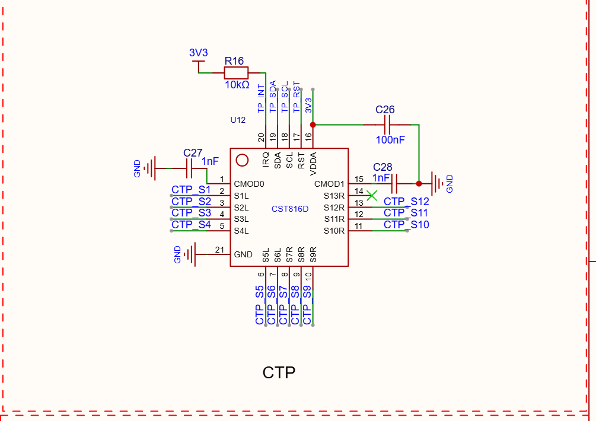

# CST816D / CST810 / CST820 触摸芯片替换评估报告

## 1 评估结论与规格对照

项目：HXESP3636AI0180DIC-A｜1.8英寸、360×360显示与触摸系统

版本：V1.0｜日期：2026-10-30｜性质：基于所提供手册与原理图的设计评估，未做换芯实测

**结论：CST810、CST820均不能在现有PCB上直接替换CST816D。CST810存在感应脚不兼容和最大通道数不足的问题；CST820通道数量充足，可作为改板后验证的候选方案。**

| 项目 | CST816D（现有基准） | CST810 | CST820 |
| --- | --- | --- | --- |
| 外围引脚/本体 | QFN20 / 3×3 mm | QFN20 / 3×3 mm | QFN24 / 3×3 mm |
| 引脚间距 / 典型厚度 | 0.40 / 0.55 mm | 0.40 / 0.55 mm | 0.35 / 0.55 mm |
| 最大感应通道 | 13路 | 10路 | 17路 |
| 供电 / 接口电平 | 2.8～3.6 V / 支持3.3 V | 2.8～3.6 V / 支持3.3 V | 2.8～3.6 V / 支持3.3 V |
| I²C频率 / 常用7位地址 | 10～400 kHz / 0x15 | 10～400 kHz / 0x15 | 10～400 kHz / 0x15 |
| CMOD电容 | 1～5.6 nF，通常1 nF | 1～5.6 nF，通常1 nF | 1～5.6 nF，通常1 nF |
| 建议TP尺寸 | 1.8英寸以内 | 1.8英寸以内 | 2英寸以内 |
| 现有板直接换芯 | 原设计器件 | 不支持：感应脚及通道数不同 | 不支持：封装及脚位不同 |
| 改板评估结论 | 保留现有方案 | 不推荐用于现有12路接线方案 | 可继续评估，需改板和厂家调参 |

判断边界：原理图显示12路CTP电极网络，未提供屏体电极图，不能确认这些电极的实际用途或断言任意通道重接后即可正常工作。

表内尺寸与参数为所给版本手册数据；相同3×3 mm外形不代表焊盘、引脚或固件兼容。两款候选芯片均不能作为免改板、免调参替代料。

## 2 现有电路与可复用条件

依据[S4]：触摸控制器为板载U12（CST816D）；感应输入引出CTP_S1～CTP_S12，S13R（14脚）未连接。

| 信号 | 现有连接 | CST816D脚号 | CST810脚号 | CST820脚号 |
| --- | --- | --- | --- | --- |
| VDDA | 3.3 V | 16 | 16 | 19 |
| RST | GPIO40 | 17 | 17 | 21 |
| SCL | GPIO14 | 18 | 18 | 22 |
| SDA | GPIO15 | 19 | 19 | 23 |
| IRQ / INT | GPIO11，R16上拉10 kΩ | 20 | 20 | 24 |
| CMOD0 / CMOD1 | C27 / C28：各1 nF到地 | 1 / 15 | 1 / 15 | 1 / 18 |

主控侧：SDA/SCL与IMU、RTC共享总线；图中R13、R14各为10 kΩ上拉。改用CST820时可保留GPIO功能分配，但须将线路接到其新脚位，并复核总线电容、并联上拉及实际速率。

电源与电容：3.3 V在三款芯片的供电范围内；C27、C28各1 nF符合CMOD推荐容量。电容材质应核对为C0G/NP0、精度±10%或更好。U12附近仅画C26=100 nF，应核对并补齐贴近芯片的储能去耦；手册引脚说明推荐2.2～10 µF，应用规范示例为0.1 µF并10 µF。

接口边界：H2为原始电极接口，3～14脚对应S1～S12，1/15脚接地，2脚未接。它不是带供电及I²C的完整触摸模组接口，不能直接接入成品I²C触摸模组。

## 3 逐脚功能对照

依据：CST816D[S1]第2/4页、CST810[S2]第2/3页、CST820[S3]第2/4页。表中比较的是脚号功能；不同封装中的相同脚号不代表物理焊盘位置一致。

| 脚号 | CST816D | CST810 | CST820 | 本板CST816D现有网络 |
| --- | --- | --- | --- | --- |
| 1 | CMOD0 | CMOD0 | CMOD0 | C27，1 nF到地 |
| 2 | S1L | ID1 | S01 | CTP_S1 |
| 3 | S2L | S1L | S02 | CTP_S2 |
| 4 | S3L | S2L | S03 | CTP_S3 |
| 5 | S4L | S3L | S04 | CTP_S4 |
| 6 | S5L | S4L | S05 | CTP_S5 |
| 7 | S6L | S5L | S06 | CTP_S6 |
| 8 | S7R | NC | S07 | CTP_S7 |
| 9 | S8R | S6R | S08 | CTP_S8 |
| 10 | S9R | S7R | S09 | CTP_S9 |
| 11 | S10R | S8R | S10 | CTP_S10 |
| 12 | S11R | S9R | S11 | CTP_S11 |
| 13 | S12R | S10R | S12 | CTP_S12 |
| 14 | S13R | ID2 | S13 | 未连接 |
| 15 | CMOD1 | CMOD1 | S14 | C28，1 nF到地 |
| 16 | VDDA | VDDA | S15 | 3V3 |
| 17 | RST | RST | S16 | TP_RST |
| 18 | SCL | SCL | CMOD1 | TP_SCL |
| 19 | SDA | SDA | VDDA | TP_SDA |
| 20 | IRQ | IRQ | S17 | TP_INT |
| 21 | — | — | RST | — |
| 22 | — | — | SCL | — |
| 23 | — | — | SDA | — |
| 24 | — | — | INT | — |
| 底部焊盘 | GND（原理图标21） | GND | GND | GND |

CST810关键差异：2脚由感应输入变为ID1，8脚变为NC，14脚变为ID2，其余多路感应输入的顺序改变。原有CTP_S1及CTP_S7不能按现接线继续作为原感应输入使用。

CST820关键差异：外围引脚由20变为24、间距由0.40变为0.35 mm；CMOD1、VDDA、RST、SCL、SDA、INT均须按新封装重新布线。

## 4 替代方案与实施要求

### 4.1 保留CST816D：现有设计基准

现有原理图按CST816D设计，封装、主控连接及12路电极网络与其能力相符。若目标是最少硬件改动，应优先保留该芯片，并另行定位现有触摸异常；本报告不将过往滑动故障归因为芯片型号，也不证明现有样机性能合格。

### 4.2 CST810：不推荐用于现有12路接线方案

主控接口、供电、CMOD和封装主要尺寸基本接近，但不是引脚兼容器件。最多10路感应能力无法一一承接图上12路电极网络；驱动软件或坐标方向设置不能增加物理感应通道。

如必须采用CST810，应先取得TP电极图，并由屏厂确认是否能使用10路或重新设计屏体电极方案，再修改PCB/FPC映射、处理ID1/ID2与NC、核对焊盘尺寸并取得专用固件。不能自行将两路电极短接、删除或随意合并。仅改PCB接线仍不能保证原屏体可用。

### 4.3 CST820：可作为改板验证候选

最多17路感应输入，从数量上覆盖现有12路。供电、电平、I²C能力、低有效复位及可配置中断边沿具备与本主控系统配合的条件；没有CST810的通道数量短缺限制。

必须将U12改为QFN24、3×3 mm、0.35 mm间距封装，重布电源、控制线、CMOD和底部接地焊盘。也可评估专用转接板做样机验证，但需控制CMOD及感应走线长度，不能等同于原位换芯。

CTP_S1～CTP_S12映射至S01～S12可作为提交厂家核对的候选：对应CST820第2～13脚。此映射不是已验证方案；最终通道顺序、剩余S13～S17的处理及扫描配置由电极图和厂家固件确定。

取得适配现有玻璃、盖板厚度、贴合方式与LCD干扰环境的CST820固件及参数，重新验证边缘、轨迹和释放事件。供电去耦和CMOD容量虽可参考原值，仍需按实际本体电容与布局确认。

### 4.4 三款芯片的软件兼容边界

三份手册均说明常用7位地址为0x15，但也明确项目地址可能不同。相同地址和I²C读写示例只证明通信机制相近，不能证明坐标、触点数、手势、芯片ID、休眠控制寄存器及启动配置兼容。应取得各型号项目固件的完整寄存器说明后适配。

三款上电/复位初始化时间均给出至少100 ms，复位低脉冲至少0.1 ms；具体驱动还应遵循厂家项目固件的时序要求。

## 5 验证计划、资料依据与建议

| 阶段 | 核查项目 | 通过条件 / 输出 |
| --- | --- | --- |
| 设计输入 | TP电极图、通道顺序、PCB焊盘、厂家固件与寄存器表 | 获得明确的通道映射和可追溯固件版本 |
| 原理图/PCB | 封装、底焊盘、供电、CMOD、感应走线、I²C/INT/RST | 完成逐网核对；去耦布局及电容材质符合手册 |
| 上电/通信 | 3.3 V及纹波、复位时序、I²C地址、SDA/SCL上升沿 | 供电2.8～3.6 V，纹波≤50 mV；通信稳定 |
| 坐标/触点 | 360×360全区域、四边/四角/中心、连续水平及垂直轨迹 | 无明显死区、跳点、坐标异常；按下与释放完整 |
| 连续操作 | 多次滑动、长按、抬手重按，记录原始报文和INT | 达到项目约定测试时长/次数；无卡住或触点滞留 |
| 模式/干扰 | 待机/休眠唤醒、LCD动画、背光PWM、充电、无线活动 | 各工况稳定；功耗、响应时间满足项目目标 |

测试说明：现有随机滑动失效现象可作为回归测试场景，但本报告没有运行新样机，也未形成故障根因结论。量产前应另外制定环境、ESD及可靠性验证标准。

### 5.1 资料清单

[S1] CST816D数据手册V1.0.pdf；引用范围：第1、2、4、6、7、10、11、12页。

[S2] CST810.pdf；引用范围：第1、2、3、4、6、8、9、10、11页。

[S3] CST820数据手册V1.1.pdf；引用范围：第1、2、3、4、6、7、10、11、12页。

[S4] HXESP3636AI0180DIC-A.png；引用范围：U12/CTP、H2、GPIO分配表、I²C上拉电路。

资料位置：F:\softwork_2.0\HXESP3636AI0180DIC-A\TP更换评估

### 5.2 尚待提供/确认的信息

① 触摸玻璃电极图、FPC定义和本体电容；② 现有PCB封装与布线文件、实际BOM；③ 候选芯片完整订货料号（CST820手册订货表为CST820-R）；④ 厂家项目固件、寄存器表及烧录方式；⑤ 实测电源、总线波形与替换样机结果。

### 5.3 选型建议

**不改PCB：继续使用CST816D。允许改PCB且希望保留现有屏体：优先推进CST820的厂家匹配和样机验证。CST810仅在厂家确认可采用10路电极方案或重新设计屏体时继续评估。**

结论状态：资料评估完成；直接替换均不成立；CST820改板替代属于有条件可行，尚未达到样机验证或量产批准状态。
